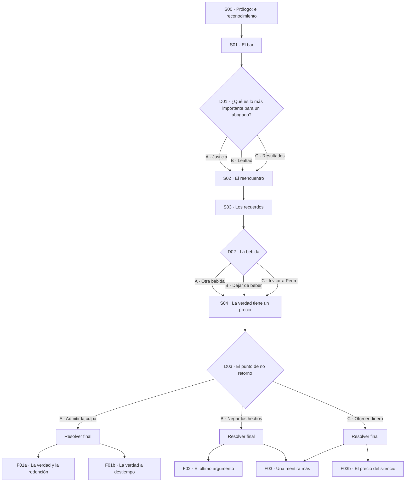

# Árbol técnico de decisiones — JogoPro

Especificación implementable del material narrativo de `Historia.md`. Tres decisiones, tres variables, cinco finales (tres canónicos + dos variantes de matiz).

## 1. Convenciones

| Prefijo | Tipo | Descripción |
| --- | --- | --- |
| `S` | Escena | Unidad de lectura sin elección. |
| `D` | Decisión | Nodo con 2–3 opciones. |
| `F` | Final | Nodo terminal. |
| `flag` | Bandera | Estado booleano que altera texto, no aritmética. |

Formato de opción: `D01.A`, `D01.B`, `D01.C`.

Regla de diseño: **toda opción es defendible desde el punto de vista del jugador**. Ninguna se etiqueta como "buena" o "mala" en la interfaz.

## 2. Variables

| ID | Nombre | Inicial | Rango | Se incrementa con | Representa |
| --- | --- | --- | --- | --- | --- |
| `res` | Resentimiento | 1 | 0–6 | Hipocresía, evasión, negación, dinero. | El rencor acumulado de Pedro. |
| `conf` | Confianza | 0 | 0–2 | Escucha activa, dejar de beber. | Disposición de Pedro a escuchar. |
| `luc` | Lucidez | 0 | 0–2 | Dejar de beber, evitar evasión. | Capacidad de Gabriel de afrontar la situación. |

Reglas de saturación: `res = clamp(res, 0, 6)`, `conf = clamp(conf, 0, 2)`, `luc = clamp(luc, 0, 2)`.

`res` arranca en 1 porque Pedro ya tiene una sospecha formada antes de la primera línea: el jugador no parte de cero.

### Banderas

| Flag | Se activa en | Efecto |
| --- | --- | --- |
| `pedro_desprecio` | `D01.C` | Diálogos de Pedro con desprecio explícito en `S03` y `S04`. |
| `evasion` | `D02.A` | Gabriel evita el tema; habilita réplica de `S04`. |
| `imprevisible` | `D02.C` | `S04` puede desviarse hacia recuerdos incómodos. |
| `alcohol` | `D02.A` o `D02.C` | La confesión de `D03.A` se lee como autocompasión. |
| `alexandre_presente` | `S01`–`S03` | Se desactiva al inicio de `S04`. |

## 3. Grafo



## 4. Escenas

### S00 · Prólogo: el reconocimiento

- **Tipo:** escena lineal, sin decisiones.
- **Condición de entrada:** inicio del juego.
- **Objetivo:** establecer la contradicción entre el prestigio público de Gabriel y su pasado.
- **Contenido:** reconocimiento profesional recién recibido; un familiar menciona con orgullo las tres generaciones de abogados; Gabriel recuerda a Pedro; decide ir al bar de sus años de universidad.
- **Nota:** Gabriel no busca redención, busca olvidar.
- **Salida:** `→ S01`.

### S01 · El bar

- **Condición de entrada:** `S00` completada.
- **Activa:** `alexandre_presente`.
- **Objetivo:** presentar a Alexandre y su admiración por Gabriel.
- **Contenido:** Alexandre reconoce a Gabriel, menciona sus casos y dice que le gustaría ser como él. Le hace la pregunta de `D01`.
- **Salida:** `→ D01`.

### S02 · El reencuentro

- **Condición de entrada:** cualquier opción de `D01`.
- **Objetivo:** revelar que Pedro está en el bar y ha escuchado la respuesta.
- **Contenido:** Pedro responde según `D01` (ver tabla 5.1). Gabriel lo reconoce.
- **Salida:** `→ S03`.

### S03 · Los recuerdos

- **Condición de entrada:** `S02` completada.
- **Objetivo:** incomodidad creciente; Pedro rememora los años en el bufete.
- **Contenido:** Pedro bebe desde hace rato, saluda con ironía, menciona momentos compartidos. Alexandre nota la tensión y ofrece otra bebida.
- **Salida:** `→ D02`.

### S04 · La verdad tiene un precio

- **Condición de entrada:** cualquier opción de `D02`.
- **Desactiva:** `alexandre_presente`.
- **Objetivo:** Pedro pasa de los recuerdos al daño concreto.
- **Contenido:** Pedro cuenta la deuda, el desempleo, el efecto en su familia. Lanza la pregunta del punto de no retorno.
- **Variantes de texto:** si `flag evasion` → Pedro señala la evasión antes de hablar del daño. Si `flag imprevisible` → inserta un recuerdo compartido que incomoda más. Si `flag pedro_desprecio` → acusa directamente a Gabriel de haberlo hundido.
- **Salida:** `→ D03`.

## 5. Decisiones

### 5.1 D01 · ¿Qué es lo más importante para un abogado?

Pregunta de Alexandre en `S01`.

| Opción | Texto | `res` | `conf` | `luc` | Flags | Respuesta de Pedro |
| --- | --- | --- | --- | --- | --- | --- |
| `D01.A` | «La justicia.» | +1 | 0 | 0 | — | «Qué curioso escuchar eso de ti.» |
| `D01.B` | «La lealtad.» | +2 | 0 | 0 | — | «Supongo que algunos compañeros no cuentan dentro de esa lealtad.» |
| `D01.C` | «Conseguir resultados.» | +2 | 0 | 0 | `pedro_desprecio` | «Entonces supongo que lo mío fue un resultado necesario.» |

Ninguna opción es incorrecta. `D01.C` es la más peligrosa precisamente porque es la más honesta: Pedro la interpreta como una confesión cínica.

### 5.2 D02 · La bebida

Oferta de Alexandre en `S03`.

| Opción | Texto | `res` | `conf` | `luc` | Flags | Efecto |
| --- | --- | --- | --- | --- | --- | --- |
| `D02.A` | Pedir otra bebida. | +2 | 0 | −1 | `evasion`, `alcohol` | Pedro lo lee como indiferencia. |
| `D02.B` | Dejar de beber y escuchar. | 0 | +1 | +1 | — | Pedro baja la guardia parcialmente. |
| `D02.C` | Invitar a Pedro a beber. | +1 | +1 | 0 | `imprevisible`, `alcohol` | Familiaridad momentánea, conversación impredecible. |

`D02.B` es la única opción que produce `luc = 1` y, por lo tanto, la única ruta hacia la redención plena.

### 5.3 D03 · El punto de no retorno

Pregunta de Pedro en `S04`: «¿Alguna vez te has preguntado qué habría pasado si hubieras dicho la verdad?»

| Opción | Texto | Condición de visibilidad | Resolución |
| --- | --- | --- | --- |
| `D03.A` | Admitir la culpa. | Siempre. | `F01a` si `conf ≥ 1` y `luc ≥ 1`; si no, `F01b`. |
| `D03.B` | Negar los hechos. | Siempre. | `F02` si `res ≥ 4`; si no, `F03`. |
| `D03.C` | Ofrecer dinero. | Siempre. | `F03b` si `res ≥ 5`; si no, `F03`. |

Diálogos base:

- `D03.A`: «No tengo ninguna excusa. Sé que no puedo devolverte lo que perdiste, pero puedo dejar de esconder lo que hice.»
- `D03.B`: «No puedes responsabilizarme de todo lo que te ha pasado. Yo también tuve que tomar decisiones difíciles.»
- `D03.C`: «Puedo ayudarte. No tienes que seguir viviendo así. Podemos dejar todo esto atrás.»

## 6. Reglas de resolución

Se evalúan en orden; la primera que coincide gana.

| Prioridad | Condición | Final |
| --- | --- | --- |
| 1 | `opcion == D03.A && conf >= 1 && luc >= 1` | `F01a` |
| 2 | `opcion == D03.A` | `F01b` |
| 3 | `opcion == D03.B && res >= 4` | `F02` |
| 4 | `opcion == D03.C && res >= 5` | `F03b` |
| 5 | `opcion == D03.B \|\| opcion == D03.C` | `F03` |

### Finales

| ID | Nombre | Tipo | Descripción |
| --- | --- | --- | --- |
| `F01a` | La verdad y la redención | Responsabilidad | Confesión completa. Gabriel entrega las pruebas y asume las consecuencias. Pedro escucha, no perdona de inmediato. |
| `F01b` | La verdad a destiempo | Responsabilidad fallida | Gabriel confiesa, pero sin haber escuchado antes. Pedro no le cree: lo interpreta como otra actuación. Gabriel pierde su reputación sin obtener reconocimiento. |
| `F02` | El último argumento | Trágico | La negación colma el resentimiento. Pedro pierde el control. Gabriel muere por las consecuencias de su propia injusticia. |
| `F03` | Una mentira más | Evasión | Pedro abandona el bar. Gabriel conserva su reputación y su soledad. |
| `F03b` | El precio del silencio | Evasión agravada | La oferta de dinero se percibe como una humillación final. Pedro se marcha y hace pública la historia; Gabriel conserva el cargo, no el nombre. |

`F01b` y `F03b` son variantes de matiz añadidas para que las decisiones anteriores sigan teniendo peso en el desenlace. Si se prefiere el esquema estricto de `Historia.md`, basta con colapsar `F01b → F01a` y `F03b → F03` en la tabla de reglas.

## 7. Matriz de rutas

Cada celda es el final resultante para la combinación `D01` × `D02` × `D03`.

| D01 | D02 | `D03.A` | `D03.B` | `D03.C` |
| --- | --- | --- | --- | --- |
| A · Justicia | A · Otra bebida | `F01b` | `F02` | `F03` |
| A · Justicia | B · Dejar de beber | `F01a` | `F03` | `F03` |
| A · Justicia | C · Invitar | `F01b` | `F03` | `F03` |
| B · Lealtad | A · Otra bebida | `F01b` | `F02` | `F03b` |
| B · Lealtad | B · Dejar de beber | `F01a` | `F03` | `F03` |
| B · Lealtad | C · Invitar | `F01b` | `F02` | `F03` |
| C · Resultados | A · Otra bebida | `F01b` | `F02` | `F03b` |
| C · Resultados | B · Dejar de beber | `F01a` | `F03` | `F03` |
| C · Resultados | C · Invitar | `F01b` | `F02` | `F03` |

Distribución sobre las 27 rutas: `F01a` = 3, `F01b` = 6, `F02` = 5, `F03` = 11, `F03b` = 2.

La redención plena exige la misma combinación en los tres ejes: defender la justicia, dejar de beber y confesar. Cualquier desvío en `D02` la vuelve inalcanzable, que es exactamente el punto temático del relato.

## 8. Modelo de datos

```json
{
  "variables": {
    "res": { "initial": 1, "min": 0, "max": 6 },
    "conf": { "initial": 0, "min": 0, "max": 2 },
    "luc": { "initial": 0, "min": 0, "max": 2 }
  },
  "start": "S00",
  "scenes": {
    "S00": { "next": "S01" },
    "S01": { "next": "D01" },
    "S02": { "next": "S03" },
    "S03": { "next": "D02" },
    "S04": { "next": "D03" }
  },
  "decisions": {
    "D01": {
      "prompt": "¿Qué es lo más importante para un abogado?",
      "options": [
        { "id": "D01.A", "label": "La justicia", "next": "S02",
          "effects": { "res": 1 } },
        { "id": "D01.B", "label": "La lealtad", "next": "S02",
          "effects": { "res": 2 } },
        { "id": "D01.C", "label": "Conseguir resultados", "next": "S02",
          "effects": { "res": 2 }, "flags": ["pedro_desprecio"] }
      ]
    },
    "D02": {
      "prompt": "¿Quieres otra bebida?",
      "options": [
        { "id": "D02.A", "label": "Pedir otra bebida", "next": "S04",
          "effects": { "res": 2, "luc": -1 }, "flags": ["evasion", "alcohol"] },
        { "id": "D02.B", "label": "Dejar de beber", "next": "S04",
          "effects": { "conf": 1, "luc": 1 } },
        { "id": "D02.C", "label": "Invitar a Pedro", "next": "S04",
          "effects": { "res": 1, "conf": 1 }, "flags": ["imprevisible", "alcohol"] }
      ]
    },
    "D03": {
      "prompt": "¿Alguna vez te has preguntado qué habría pasado si hubieras dicho la verdad?",
      "resolve": "ending",
      "options": [
        { "id": "D03.A", "label": "Admitir la culpa" },
        { "id": "D03.B", "label": "Negar los hechos" },
        { "id": "D03.C", "label": "Ofrecer dinero" }
      ]
    }
  },
  "endings": {
    "rules": [
      { "when": "D03.A && conf >= 1 && luc >= 1", "ending": "F01a" },
      { "when": "D03.A", "ending": "F01b" },
      { "when": "D03.B && res >= 4", "ending": "F02" },
      { "when": "D03.C && res >= 5", "ending": "F03b" },
      { "when": "D03.B || D03.C", "ending": "F03" }
    ]
  }
}
```

## 9. Pseudocódigo del resolvedor

```ts
const clamp = (v: number, min: number, max: number) => Math.min(max, Math.max(min, v));

function applyOption(state: State, option: Option): State {
  const next = { ...state, flags: new Set(state.flags) };
  for (const [key, delta] of Object.entries(option.effects ?? {})) {
    const { min, max } = LIMITS[key];
    next[key] = clamp(next[key] + delta, min, max);
  }
  for (const flag of option.flags ?? []) next.flags.add(flag);
  return next;
}
Entrega 1 y revisión en la entrega 3
function resolveEnding(state: State, optionId: string): EndingId {
  const { res, conf, luc } = state;
  const is = (id: string) => optionId === id;

  if (is("D03.A") && conf >= 1 && luc >= 1) return "F01a";
  if (is("D03.A")) return "F01b";
  if (is("D03.B") && res >= 4) return "F02";
  if (is("D03.C") && res >= 5) return "F03b";
  return "F03";Entrega 1 y revisión en la entrega 3
}
```

## 10. Pendientes de contenido

- Texto completo de `S00`–`S04` (actualmente solo hay objetivos y diálogos clave).
- Diálogos de Pedro en `S02` para cada opción de `D01` (ya existen como cita en la tabla 5.1).
- Variante de `D03.A` sin `luc`: debe sonar sincera pero desordenada, para justificar que Pedro no la crea.
- Epílogos de `F01b` y `F03b`.

## Ver también

- [`PromptsArte.md`](PromptsArte.md) — prompts completos para generar las 25 imágenes del juego.
- `game/definitions.rpy` — implementación actual de este árbol en Ren'Py (los placeholders de color se sustituyen ahí al llegar el arte).
